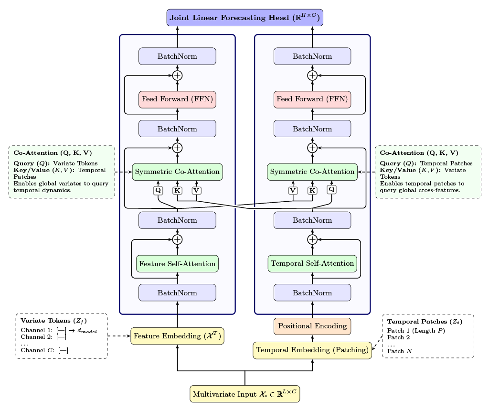

# ORACLE: Time and Feature Specialist Transformer



This repository contains the PyTorch implementation of **ORACLE: Time and Feature Specialist Transformer for Time Series Forecasting**.

ORACLE is a dual-stream Transformer architecture designed for multivariate time series forecasting. It utilizes parallel Time and Feature Specialist Encoders with Symmetric Co-Attention to capture temporal dynamics and cross-variate relationships simultaneously.

---

## Repository Structure

```text
Oracle/
├── config.json          # Hyperparameter specifications and model dimensions
├── data/
│   └── ETTh1.csv        # Sample benchmark dataset
├── LICENSE              # MIT License
├── README.md            # Project documentation and run guidelines
├── src/
│   ├── oracle_forecast_plot.png
│   ├── test.py          # Standalone evaluation logic
│   ├── transformer.py   # ORACLE model definition, co-attention blocks, and encoders
│   └── utils.py         # Data loaders, indexing, metrics, and logging utilities
└── train.py             # Main entry point for training and evaluation

```

---

## Getting Started

### Prerequisites

Ensure you have Python 3.8+ and PyTorch installed.

```bash
pip install torch numpy pandas tqdm

```

---

## Usage

### 1. Configuration

Model dimensions and training hyperparameters are defined in `config.json`:

```json
{
  "model": {
    "lookback": 336,
    "horizon": 96,
    "patch_size": 16,
    "stride": 16,
    "d_model": 128,
    "dim_feedforward": 256,
    "nheads": 4,
    "num_layers": 2
  },
  "train": {
    "batch_size": 32,
    "epochs": 50,
    "learning_rate": 0.001,
    "weight_decay": 0.00001,
    "early_stopping_patience": 5
  }
}

```

### 2. Training and Evaluation

Run the standard end-to-end training and evaluation pipeline on the provided dataset:

```bash
python3 train.py --task forecasting --data data/ETTh1.csv --run_name ORACLE_ETTh1_Run --gpu 0

```

### CLI Arguments

| Argument | Type | Default | Description |
| --- | --- | --- | --- |
| `--task` | `str` | *required* | Pipeline target (`forecasting` or `pretraining`). |
| `--data` | `str` | *required* | Path to the target CSV dataset. |
| `--run_name` | `str` | `ORACLE_Run` | Experiment identifier; checkpoints and logs are saved to `results/<run_name>`. |
| `--gpu` | `int` | `0` | CUDA device ordinal to use. |
| `--disable_time` | `flag` | `False` | Disables the Time Specialist branch for ablation studies. |
| `--disable_feature` | `flag` | `False` | Disables the Feature Specialist branch for ablation studies. |
| `--mask_ratio` | `float` | `0.40` | Masking ratio applied during self-supervised pretraining tasks. |
| `--pretrained_ckpt` | `str` | `None` | Path to existing checkpoint weights for fine-tuning. |

---

## License

This project is licensed under the MIT License. See the [LICENSE](https://www.google.com/search?q=LICENSE) file for details.

```

```
